# Icons

Every icon in the interface, drawn by `src/components/Icon.vue` from the outlines in `src/icons.ts`.
`src/icons.spec.ts` fails if an icon in that file has no row or swatch here, or the other way
round, so edit them together.

An icon is the outline of a Unicode character, filled with the text colour (`currentColor`), so it
is the same in every browser and follows the theme. A character drawn as text would be placed,
sized and often coloured by whichever font the browser picks. The swatches are grey so they show
on a light or a dark page.

| Icon | Name | Codepoint | Unicode name | Used by |
|---|---|---|---|---|
| 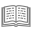 | `book` | `U+1F4D6` | Open Book | Text.vue, spaces.ts |
|  | `page` | `U+1F4C4` | Page Facing Up | TreeItem.vue |
| 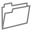 | `folder` | `U+1F4C1` | File Folder | spaces.ts |
| 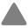 | `triangle` | `U+1F53A` | Up-Pointing Red Triangle | TreeItem.vue |
| 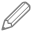 | `pencil` | `U+1F589` | Lower Left Pencil | DashboardView.vue, Text.vue |
|  | `save` | `U+1F4BE` | Floppy Disk | Text.vue |
|  | `stop` | `U+23F9` | Black Square For Stop | Text.vue |
| 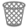 | `trash` | `U+1F5D1` | Wastebasket | Text.vue |
|  | `reroll` | `U+1F5D8` | Clockwise Right And Left Semicircle Arrows | Text.vue |
| 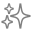 | `sparkles` | `U+2728` | Sparkles | Text.vue |
| 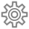 | `gear` | `U+2699` | Gear | Text.vue |
|  | `dice` | `U+1F3B2` | Game Die | Text.vue, Tree.vue |
|  | `sun` | `U+2600` | Black Sun With Rays | Tree.vue |
|  | `moon` | `U+1F319` | Crescent Moon | Tree.vue |
| 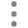 | `more` | `U+22EE` | Vertical Ellipsis | Tree.vue, TreeItem.vue |
| 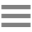 | `menu` | `U+2630` | Trigram For Heaven | App.vue |
|  | `chevron-left` | `U+00AB` | Left-Pointing Double Angle Quotation Mark | App.vue |
|  | `close` | `U+2715` | Multiplication X | SidePanel.vue |
| 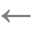 | `arrow-left` | `U+2190` | Leftwards Arrow | BackLink.vue |
|  | `arrow-up` | `U+2191` | Upwards Arrow | GitPanel.vue |
| 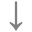 | `arrow-down` | `U+2193` | Downwards Arrow | GitPanel.vue |

## Source and licence

The outlines are the monochrome ("text style") glyphs of the Noto Emoji font, which the
codepoints.net page of each character shows as SVG. Noto Emoji is published by Google under the
SIL Open Font License, Version 1.1 (<https://github.com/googlefonts/noto-emoji>). The outlines
here are re-based to their own bounding box and flipped the right way up, and are otherwise as
published.
The one exception is `book`: its pages have lines of text on them in the font, which turn to
noise at the sizes the icon is used at (16 to 20px), so those are removed and the pages are blank.

## Adding an icon

1. Pick the character and open `https://codepoints.net/U+XXXX`. Check the page shows a glyph
   drawn as a single `<path>`, with no colour in it.
2. Copy the path's `d` and its transform, `translate(0, T) scale(1,-1)`. The font's axis points
   up, the screen's down: replace every y coordinate with `T - y`. The path uses only `M`, `L`,
   `Q` and `Z`, with absolute coordinates.
3. Find the outline's bounding box, subtract its top-left corner from every coordinate, and set
   `viewBox` to `0 0 width height`. Round to one decimal.
4. Add it to `ICONS` in `src/icons.ts` under a name that says what the icon is for, not what
   it looks like, and add a row and a swatch here. The test tells you what is missing.
5. Use it as `<Icon name="..." />`, inside a control that has its own `aria-label`.
